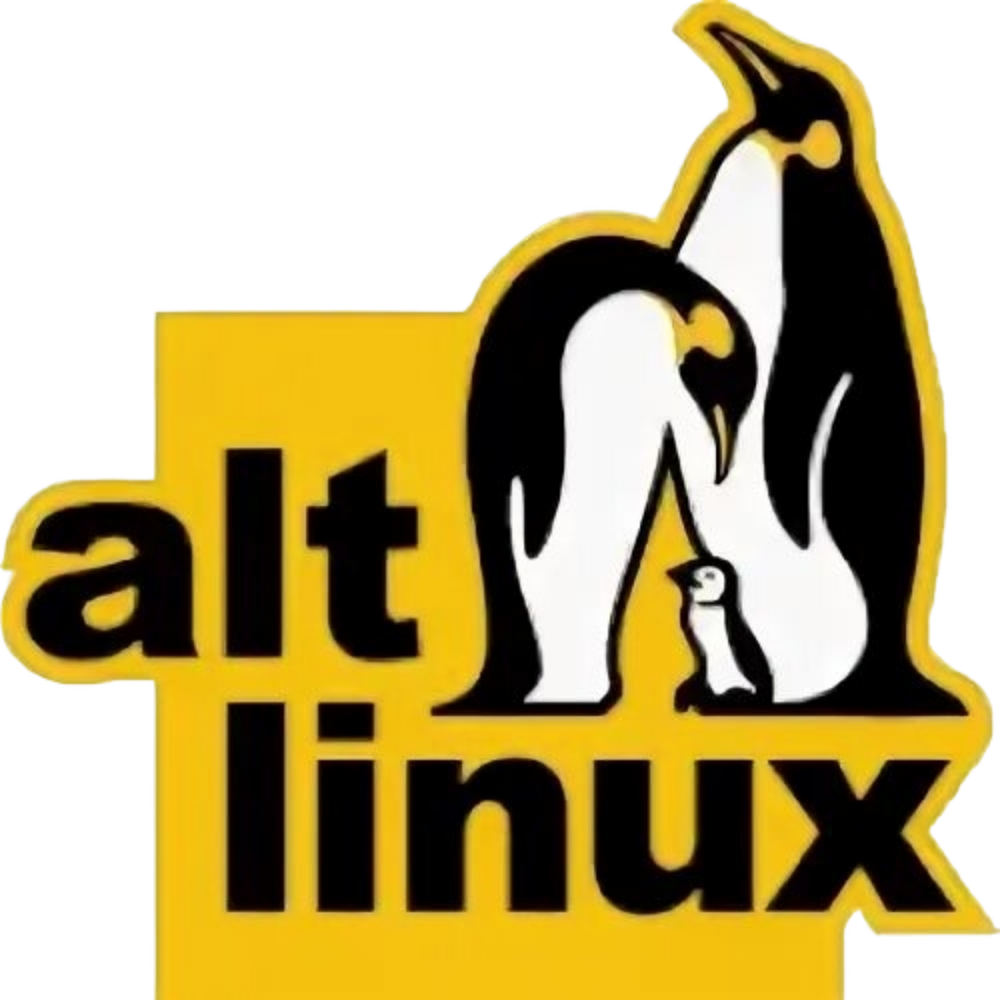

<h1 align="center">Remake of the  game “Donkey”</h1>

<p align="center"></p>
<p align="center"></p>

## Game description

A simple game in which the player drives a car but cannot steer, accelerate or brake, only changing lanes to 
avoid some donkeys on the road. There is no other goal but to avoid the donkeys.

## A little afterword

I decided to set myself a challenge: to write a game in a few evenings, not using third-party libraries like Pygame, 
but using only the standard Python libraries, namely: [tkinter](https://docs.python.org/3/library/tkinter.html), [time](https://docs.python.org/3/library/time.html), 
[random](https://docs.python.org/3/library/random.html) and [winsound](https://docs.python.org/3/library/winsound.html). All in all, it turned out very cool :)

## How to play?

###  Windows

Download the [latest version](https://github.com/YuraFX/DonkeyPy/releases/download/1.1/DonkeyPy_v1_1.zip)

###  Android (Pydroid)

> ⚠️ **IMPORTANT!** This version of the game should theoretically work on devices with a screen resolution of **480 x 854 pixels**. Tested on a BQ-5035 Velvet ([Android 7.0 Nougat](https://developer.android.com/about/versions/nougat)).

1. Install [Pydroid 3](https://play.google.com/store/apps/details?id=ru.iiec.pydroid3&hl=ru)
   
2. Install [Total Commander](https://play.google.com/store/apps/details?id=com.ghisler.android.TotalCommander&hl=ru)

3. Download [DonkeyPy_Pydroid_480x854.zip](https://github.com/YuraFX/DonkeyPy/releases/download/1.0/DonkeyPy_Pydroid_480x854.zip)
   
4. Using Total Commander, unzip the contents of the archive to any convenient place for you
   
5. Go into Pydroid and open the `donkey.py` file

6. Enjoying the game :)

> **Note:** There is **no sound** in this version of the game. It might be added in a future release.

<p align=""></p>

###  Linux (x86_64)

* #### Supported OS:
   *  Debian 10+

   *  Ubuntu 20.04+

   *  RHEL 8+

   *  Fedora 29+

   *  ALT Linux p10+

> ⚠️ **IMPORTANT!** Built and tested on [Debian 10 "Buster"](https://www.debian.org/releases/buster/). Other distributions are supported based on **glibc 2.28+** compatibility but have not been explicitly tested. A guide on how to run the game in Debian 10 is provided below:

1. Download [DonkeyPy (Linux x86_64).zip](https://github.com/YuraFX/DonkeyPy/releases/download/1.1/DonkeyPy.Linux.x86_64.zip)

2. Extract the archive. You will find a `dist` folder inside the `DonkeyPy` directory.

3. Open the `dist` folder

4. Open a Terminal inside the `dist` folder

5. Make the file executable (only needed once):
   ```bash
   chmod +x DonkeyPy
   ```
6. Run the game:
   ```bash
   ./DonkeyPy
   ```

> **Note:** Unfortunately, this version does not have sound, just like the Pydroid version.

<p align=""></p>

## License


Copyright © 2024, 2025, 2026 Yuriy Konyshev

DonkeyPy is [free software](https://www.gnu.org/philosophy/free-sw.en.html): you can redistribute it and/or modify it under the terms of the [GNU General Public License](https://www.gnu.org/licenses/gpl-3.0.en.html) as published by the [Free Software Foundation](https://www.fsf.org/), either version 3 of the License, or (at your option) any later version.

**DonkeyPy is distributed in the hope that it will be useful, but WITHOUT ANY WARRANTY; without even the implied warranty of MERCHANTABILITY or FITNESS FOR A PARTICULAR PURPOSE.** See the GNU General Public License for more details.

You should have received a [copy](https://github.com/YuraFX/DonkeyPy/blob/main/LICENSE) of the GNU General Public License along with DonkeyPy. If not, see [https://www.gnu.org/licenses/](https://www.gnu.org/licenses/licenses.en.html).
